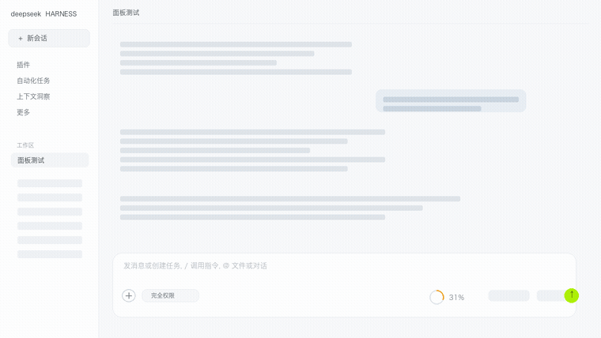
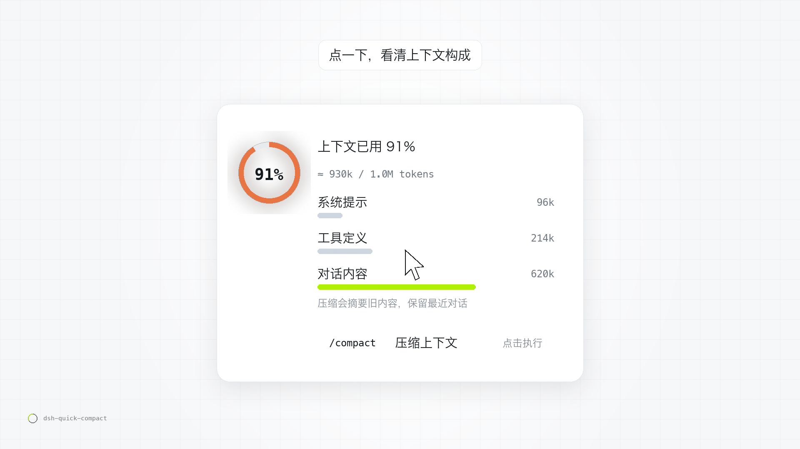
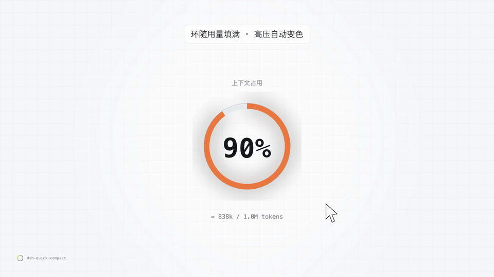
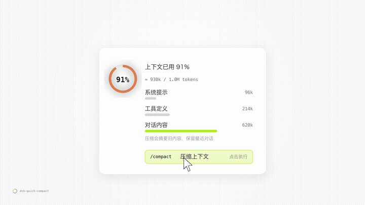

# dsh-quick-compact

**每次压缩都要手打 `/compact`？点一下就行了。**

DSH（DeepSeek Harness）输入框工具栏里的一枚小环：显示上下文用量，点开看构成，再点一下执行官方 `/compact`。纯客户端插件，不替换官方 UI，无遥测、不向第三方上报；唯一的同源请求是「压缩阈值」联动接口（未安装联动插件时自动隐藏）。

[](plugins/dsh-quick-compact/LICENSE)


[中文](#中文) · [English](#english)

---

## 中文

### 两种形态

**小环形态：输入框工具栏里的一枚小环**



DSH 的输入框下面有一行工具栏（`＋`、权限、额度、模型、麦克风、发送）。插件的小环就长在这一行——**打完字那一行的右侧、额度信息左边**。它不抢官方的位置，只在旁边多一枚更小的环。

**卡片形态：点开就是面板**



点一下小环，展开面板：大环 + `上下文已用 N%` + 三段构成（系统提示 / 工具定义 / 对话内容），最下面是 `/compact 压缩上下文` 一行。看用量、看构成、点一下压缩，都在这里。

### 点一下的样子



GIF 是示意：插件里的压缩烟花更细腻，动画约 2.2 秒，而且**整页放**——不打开面板也会放。

### 为什么做它

DSH 本来就有上下文环，但它只告诉你「用了多少」；想压缩，得自己记得去打 `/compact`。真实使用里往往是——**先看到快满了，才想起来要压缩**，中间已经多烧了几轮 token。

这个插件把「看」和「压」放在同一个控件上：**环告诉你还剩多少，点开告诉你为什么用了这么多，再点一下就直接压。**

### 功能

| | |
| --- | --- |
| **用量小环** | 18px 环 + 整数百分比，读宿主 `contextPressure` 投影（已用 ÷ 路由容量）。填充随用量增长，高压自动变色：青柠 → 橙 → 红。数据没出来时不显示假数字。 |
| **用量构成** | 点开面板：大环 + `上下文已用 N%` + `≈ 148k / 1.0M`，下面是 `contextBreakdown` 给出的三段构成：系统提示 / 工具定义 / 对话内容，各自 token 数。 |
| **一键压缩** | 面板里 `/compact 压缩上下文` 一行，点击调命令通道 `remote.commands.execute(sessionId, '/compact', [])`——和手打命令完全等价，不是自己实现的假压缩。失败会把宿主返回的错误原样显示。 |
| **压缩烟花** | 压缩发生那一刻，环心炸开一簇小方点 + 一圈冲击波，约 2.2 秒散尽。它铺在**整个页面**上（全屏画布）——不打开面板也会放：插件按钮的 `/compact` 调用返回未明确失败时播放；上下文用量一次下降 15 个百分点以上时也会触发（自动压缩通常满足）。`pointer-events:none` 不挡输入、不吃点击；`prefers-reduced-motion` 时不放。 |
| **零侵入** | 官方那只环原样保留，插件只在自己的插槽里画；不接管官方 UI，升级不易碎。 |

### 压缩烟花

| 压缩烟花：不用打开面板，界面里直接放 |
| --- |
|  |

### 安装

```sh
dsh plugin --profile <profile> add dsh-quick-compact
```

或本地安装：插件管理器 `install_bundle` → 选 `plugins/dsh-quick-compact/` 目录 → 装完硬刷新页面（`Cmd/Ctrl + Shift + R`）。

### 工作原理

- 插槽：`conversation.input.right`（输入框工具栏右侧），纯增量实现；
- 数据：宿主投影 `contextPressure` 与 `contextBreakdown`（随 DSH 基础包提供）；
- 动作：`remote.commands.execute(sessionId, '/compact', [])`，与手打命令等价；
- 降级：以上任一不可用时，退化成「只有压缩图标 + 点击面板」，不报错、不显示假数据。

### 隐私与请求范围

- **不向第三方上报、不发遥测**，不读取对话内容、不写日志。
- 打开面板时会尝试 `GET` 一次当前宿主**同源**的阈值接口 `/compaction-threshold/api/state`（用于显示「压缩触发阈值」滑块）；未安装联动插件时请求失败、控件自动隐藏。
- 拖动滑块会 `POST` 同一个同源接口，只写 `thresholdRatio` 一个字段。
- 压缩本身通过宿主官方命令通道执行，后续压缩行为由宿主配置决定。

### 兼容

DSH 0.2.x（桌面版 / Web 版）。无需额外依赖，安装后即生效。

### 相关插件与致谢

- **自动压缩引擎**：DSH 官方的 `@deepseek-ai/dsh-compaction-basic`，本插件只是触发官方 `/compact` 命令，不实现压缩逻辑。
- **可选联动**：安装了 [windwhiterain/dsh-compaction-threshold](https://github.com/windwhiterain/dsh-compaction-threshold)（MIT）时，面板里会多一条「压缩触发阈值」滑块，直接读写它的 `/compaction-threshold/api/state` 接口——**仅调用公开 HTTP 接口，未复制其代码**；未安装时该控件自动不显示，互不影响。

### 仓库里的其他东西

- `experiments/` — 性能基准（`bench/`）、A/B 对比（`ab/`）、脱敏样例（`fixtures/`）、聚合结果（`results/`）
- `scripts/` — 仓库自动化；提交前跑 `scripts/check-hygiene.sh` 自查绝对路径 / 凭据形态 / 大文件
- `.github/workflows/ci.yml` — PR 校验（语法、package.json 完整性、禁止绝对路径）

### 参与

欢迎 issue / PR。规则见 [CONTRIBUTING.md](CONTRIBUTING.md)，安全问题见 [SECURITY.md](SECURITY.md)。

### 许可

MIT，见 [LICENSE](plugins/dsh-quick-compact/LICENSE)。

---

## English

**A tiny ring in your DSH composer: see your context, compact with one click.**

A client-side plugin for DeepSeek Harness that adds a ring gauge next to the built-in context meter. It shows context usage, breaks it down by system prompt / tool definitions / conversation, and runs the official `/compact` command when you click. No telemetry and nothing sent to third parties; the only requests are same-origin calls to the optional threshold endpoint. No UI replacement.

### Two forms

**Ring form — in the composer toolbar**


DSH has a toolbar row under the composer (`+`, permissions, usage, model, mic, send). The ring sits on that row — right side of the composer, just left of the usage meter.

**Panel form — click the ring**


Click the ring and the panel opens: a big ring, `context used N%`, a three-part breakdown (system prompt / tool definitions / conversation), and a `/compact` row.

### See it in action


This GIF is illustrative: the real fireworks are finer, run for about 2.2s on a full-page canvas, and play with or without the panel open.

### Features

- **Ring gauge** — 18px ring + integer percentage from the host's `contextPressure` projection; fills as context grows and shifts lime → amber → red under pressure.
- **Breakdown** — a popover with a big ring, `context used N%`, `≈ 148k / 1.0M`, and a three-part breakdown (system prompt / tool definitions / conversation) from `contextBreakdown`.
- **One-click compact** — runs `remote.commands.execute(sessionId, '/compact', [])`, identical to typing the command yourself.
- **Fireworks** — a ~2.2s particle burst + shockwave drawn over the whole page; plays with or without the panel open, when the plugin's `/compact` call does not explicitly fail, and when measured context usage drops by ≥15 percentage points (auto-compaction usually does). `pointer-events:none`, disabled under `prefers-reduced-motion`.
- **Zero-invasion** — the built-in meter stays untouched; the plugin renders in its own slot.

### Install

```sh
dsh plugin --profile <profile> add dsh-quick-compact
```

### Compatibility & privacy

DSH 0.2.x (desktop / web). Client-side only: no telemetry, nothing sent to third parties, no conversation content read. The only requests are same-origin calls to the optional `/compaction-threshold/api/state` endpoint (hidden when that plugin is absent).

### Repo layout

- `plugins/dsh-quick-compact/` — the plugin
- `experiments/` — benchmarks, A/B runs, fixtures, aggregated results
- `scripts/` — repo automation (`check-hygiene.sh` runs before commits)
- `.github/workflows/ci.yml` — PR validation

### License

MIT.
