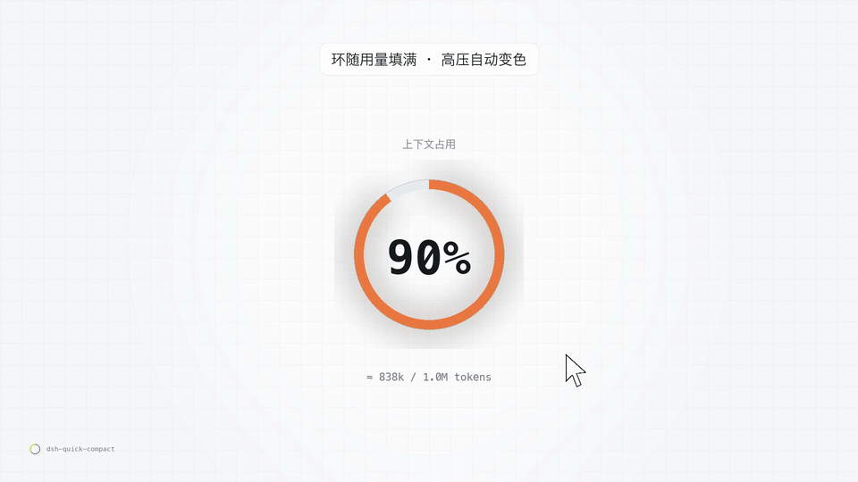
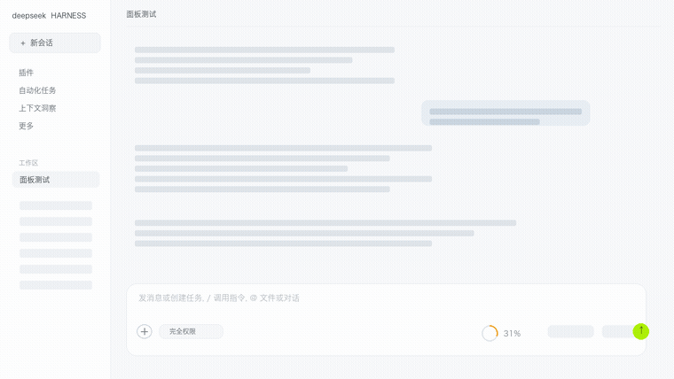
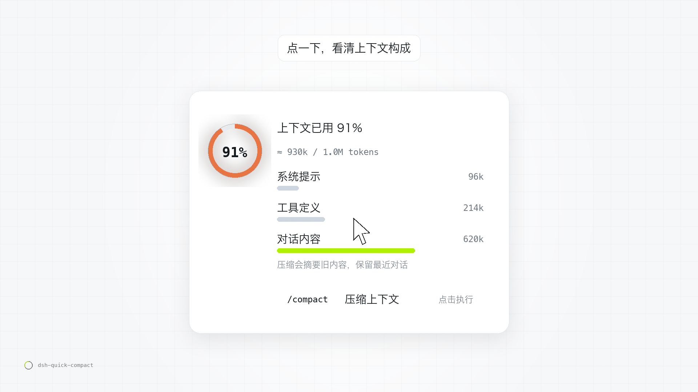
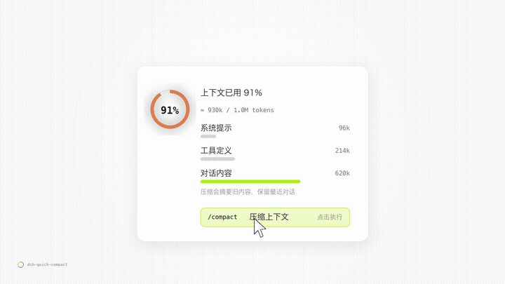

# dsh-quick-compact

[中文](#中文) · [English](#english)

每次压缩都要手打 `/compact`？在 [DeepSeek Harness](https://github.com/deepseek-ai/deepseek-harness)（DSH）输入框工具栏里点一下小环就行。





<p align="center">
  
</p>

<p align="center">
  
</p>

## 中文

### 它是什么

DSH 输入框右下角本来就有一只官方上下文环，但它只显示数字；想压缩得手打 `/compact`。

这个插件在**输入框工具栏**里再放一枚更小的环（18px + 百分比），点它一次展开用量构成，再点 `/compact` 那一行就执行官方压缩——和手打命令完全等价，压缩成功还有一簇烟花。

### 功能

- **用量小环**：读宿主的 `contextPressure` 投影（已用 ÷ 路由容量），显示整数百分比；环随用量填满，高压时自动变色（青柠 → 橙 → 红）。
- **点开面板**：大号环 + `上下文已用 N%` + `≈ 148k / 1.0M`，下面是 `contextBreakdown` 投影给出的构成条：系统提示 / 工具定义 / 对话内容，各自 token 数。
- **执行压缩**：点 `/compact 压缩上下文` → 调命令通道 `remote.commands.execute(sessionId, '/compact', [])`，与手打命令等价；失败把宿主返回的错误原样显示。
- **压缩烟花**（v1.4.0+）：压缩成功那一刻，环心炸开一簇小方点 + 一圈冲击波，1.4 秒散尽；全屏 canvas 覆盖层、`pointer-events:none`，不挡输入。`prefers-reduced-motion` 时不放。
- **不替换官方 UI**：官方那只环原样保留，插件只在自己的插槽里画，零侵入。

### 安装

```sh
# 从插件市场 / npm 形态安装（DSH 0.2.x）
dsh plugin --profile <profile> add dsh-quick-compact
```

或本地目录安装：插件管理器 `install_bundle` → 选本目录，装完硬刷新页面（`Cmd/Ctrl + Shift + R`）。

### 兼容

- DSH 0.2.x（桌面版 / Web 版），客户端插槽 `conversation.input.right`，纯增量实现。
- 依赖宿主投影 `contextPressure`（`@deepseek-ai/dsh-token-meter` 注册，随 DSH 基础包提供）与命令通道 `remote.commands`；缺任一个时降级为「只有压缩图标」，不报错。

### 相关插件与致谢

- 自动压缩引擎是 DSH 官方的 `@deepseek-ai/dsh-compaction-basic`；本插件只触发官方 `/compact`，不自带压缩实现。
- 可选联动 [windwhiterain/dsh-compaction-threshold](https://github.com/windwhiterain/dsh-compaction-threshold)（MIT）：装了它，面板里会多一条压缩阈值滑块，通过其公开 HTTP 接口读写；**未复制其代码**，未安装时该控件自动隐藏。

### 许可

MIT，见 [LICENSE](LICENSE)。

## English

A tiny ring gauge in the [DeepSeek Harness](https://github.com/deepseek-ai/deepseek-harness) composer toolbar: see how full your context is, open a breakdown, and compact with one click.

### What it does

- **Ring gauge**: reads the host's `contextPressure` projection, shows an integer percentage, fills as the context grows, and shifts color under pressure (lime → amber → red).
- **Popover**: big ring + `context used N%` + `≈ 148k / 1.0M`, plus a breakdown of system prompt / tool definitions / conversation with token counts from `contextBreakdown`.
- **One-click compact**: clicking `/compact` runs the official command channel (`remote.commands.execute(sessionId, '/compact', [])`) — identical to typing it yourself.
- **Fireworks**: on a successful compact, a small burst of particles and a shockwave ring play for 1.4s on a `pointer-events:none` canvas overlay (skipped under `prefers-reduced-motion`).
- **Non-invasive**: the built-in context meter stays untouched; the plugin renders in its own slot.

### Install

```sh
dsh plugin --profile <profile> add dsh-quick-compact
```

Or install the directory through the plugin manager, then hard-refresh the page.

### Compatibility

DSH 0.2.x (desktop / web). Uses the `conversation.input.right` client slot and degrades gracefully when `contextPressure` or `remote.commands` is unavailable.

### License

MIT. See [LICENSE](LICENSE).
